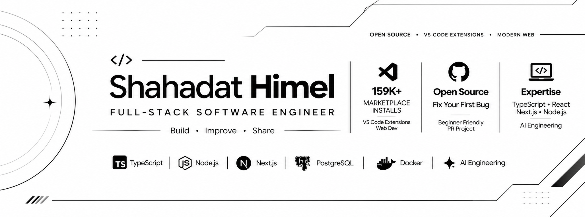

  

 

## About Me

**Full-Stack Software Engineer with 4+ years of professional experience** designing and delivering high-performance, accessible, and scalable web applications. Much of my production experience comes from building and maintaining software for enterprise environments and client projects through private repositories.

This public workspace documents my current full-stack and AI engineering R&D—focusing on distributed backend architectures, end-to-end type safety, and agentic product workflows. Everything published here is built to explore production-grade system design, performance boundaries, and modern developer tooling.

### Professional Experience

**Frontend Engineer — [Cartup](https://cartup.com)**

- **Customer Site:** Built and maintained the customer-facing e-commerce experience on cartup.com.
- **Admin & Operations Tooling:** Developed the Admin Dashboard, Seller Dashboard, Logistics Dashboard, and Accounting Dashboard, plus the admin functionality that powers them.

### My Contribution to the Developer Community

I build small, focused tools that remove friction for other developers and make best practices the default.

**VS Code Extensions** — two published tools with **159,000+ combined Marketplace installs**:

- **[Web Dev](https://marketplace.visualstudio.com/items?itemName=c0der-himel.vscode-wev-dev-extension-pack)** — a one-install extension pack that turns a fresh editor into a complete frontend environment with 23 curated extensions for HTML, CSS, JavaScript, React, Tailwind CSS, Git, linting, and formatting. **89,000+ installs.**
- **[Remove Console Log](https://marketplace.visualstudio.com/items?itemName=c0der-himel.remove-console-log)** — removes every `console.log` from the active file in one command. Syntax-aware parsing handles nested calls, multi-line arguments, JSX, and TypeScript without breaking code or control flow. **69,000+ installs.**

**Open Source — [Fix Your First Bug](https://github.com/dev-himel-0o0/fix-your-first-bug)** ([live demo](https://fix-your-first-bug.vercel.app/)): A deliberately small Next.js playground with three intentionally broken TypeScript functions. First-time contributors fix one bug and practice the real fork → branch → commit → pull request workflow, with instant visual feedback and CI on every PR, in a codebase small enough to understand in one sitting. It gives beginners a safe place to build confidence before stepping into larger open-source projects — and a repeatable workflow they can use on every contribution that follows.

### Engineering Principles

- **Architecture Over Boilerplate:** In an era where AI generates code in seconds, I focus on strict runtime validation (Zod), predictable state machines, transactional data integrity, and maintainable module boundaries.
- **Performance by Default:** Optimizing Core Web Vitals, database indexing, query execution plans, and rendering lifecycles so complex, data-heavy interfaces feel instantaneous.
- **Async-First Execution:** Writing clear architectural decision records (ADRs), atomic commits, OpenAPI specifications, and self-documented codebases designed for global remote teams.

### Current Focus & Explorations

- **AI-Native Product Engineering:** Architecting LLM-powered workflows with structured outputs, vector search (RAG), tool calling, and resilient streaming UIs.
- **Enterprise Backend Patterns:** Designing modular, multi-tenant backend services with role-based access control (RBAC), transactional rollbacks, and caching layers.
- **Full-Stack Type Safety:** Building monorepo architectures that unify database schemas, API contracts, and frontend state.

## Skills & Technologies

### Languages & Frameworks

### AI Engineering

### Tools & DevOps

## Connect With Me

  I'm always open to discussing technology, collaborating on projects, and connecting with fellow developers.

_Let's build something meaningful together._
